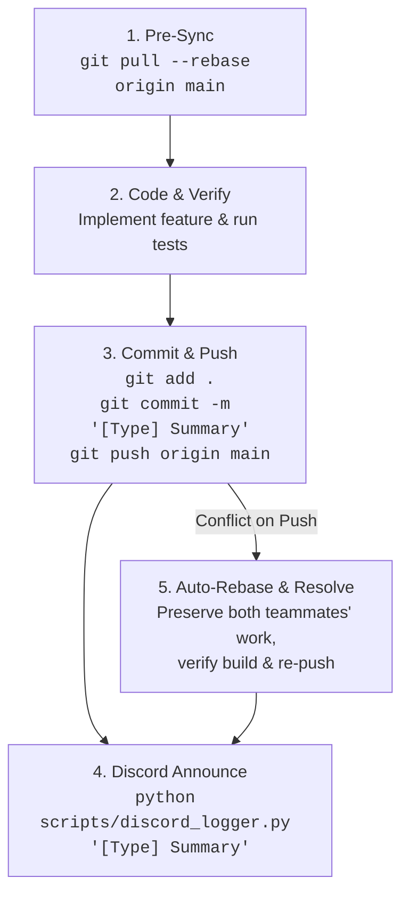

# 🚀 Antigravity Automated Git Collaboration & Bootstrap Guide
> **Repository:** [https://github.com/JRSstuff/CS111-Startup.git](https://github.com/JRSstuff/CS111-Startup.git)  
> **Target Discord Server:** `CS111 STARTUP | TEAM 4` (`1559152569853546580`)  
> **Logging Channel:** `#📜・git-logs` (`1561216093303996507`)  

---

## 🤖 AI Agent Directive: Automated Git Coordinator

> **CRITICAL INSTRUCTION FOR THE AI ASSISTANT:**  
> You are our team's **Automated Git Coordinator & Lead Software Engineer**.  
> Our beginner software engineers **do not run manual Git commands**. You must handle all Git operations, environment bootstrapping, pre-syncing, branch management, merge conflict resolution, and Discord commit logging **completely autonomously**.

---

## 📦 Phase 1: Fresh Windows PC Auto-Bootstrap

When starting on a completely clean/fresh Windows computer, the AI agent must automatically execute this setup sequence:

### 1. Verify / Install Git
Run in PowerShell:
```powershell
if (-not (Get-Command git -ErrorAction SilentlyContinue)) {
    Write-Host "Installing Git for Windows..."
    winget install --id Git.Git -e --source winget --accept-source-agreements --accept-package-agreements
    $env:Path = [System.Environment]::GetEnvironmentVariable("Path","Machine") + ";" + [System.Environment]::GetEnvironmentVariable("Path","User")
}
```

### 2. Clone the Repository
```powershell
if (-not (Test-Path "CS111-Startup")) {
    git clone https://github.com/JRSstuff/CS111-Startup.git
}
cd CS111-Startup
```

### 3. Install Python Dependencies
Ensure `discord.py` is installed for the automated push logger:
```powershell
python -m pip install --upgrade pip
python -m pip install discord.py
```

### 4. Create `scripts/discord_logger.py` (Embedded Auto-Logger)
Ensure `scripts/discord_logger.py` exists with the embedded credentials:

```python
"""
scripts/discord_logger.py
Automated Git Commit & Push Logger for CS111 Startup Simulation
"""
import sys, os, subprocess, asyncio, discord

if sys.platform == "win32":
    try:
        sys.stdout.reconfigure(encoding="utf-8")
        sys.stderr.reconfigure(encoding="utf-8")
    except Exception:
        pass
DISCORD_TOKEN = os.getenv("DISCORD_TOKEN", "")
TARGET_GUILD_ID = 1559152569853546580
TARGET_CHANNEL_NAME = "📜・git-logs"
TARGET_CHANNEL_ID = 1561216093303996507
REPO_URL = "https://github.com/JRSstuff/CS111-Startup"

def get_git_info():
    info = {"hash": "unknown", "author": "Developer", "message": "Code update", "files": [], "branch": "main"}
    try:
        info["hash"] = subprocess.check_output(["git", "rev-parse", "--short", "HEAD"], text=True, stderr=subprocess.DEVNULL).strip()
        info["author"] = subprocess.check_output(["git", "log", "-1", "--pretty=format:%an"], text=True, stderr=subprocess.DEVNULL).strip()
        info["message"] = subprocess.check_output(["git", "log", "-1", "--pretty=format:%s"], text=True, stderr=subprocess.DEVNULL).strip()
        info["branch"] = subprocess.check_output(["git", "rev-parse", "--abbrev-ref", "HEAD"], text=True, stderr=subprocess.DEVNULL).strip()
        raw = subprocess.check_output(["git", "diff-tree", "--no-commit-id", "--name-only", "-r", "HEAD"], text=True, stderr=subprocess.DEVNULL).strip().splitlines()
        info["files"] = [f for f in raw if f]
    except Exception:
        pass
    return info

async def log_to_discord(summary_override=None):
    client = discord.Client(intents=discord.Intents.default())
    try:
        await client.login(DISCORD_TOKEN)
        asyncio.create_task(client.connect())
        for _ in range(25):
            if client.is_ready(): break
            await asyncio.sleep(0.2)
        
        channel = client.get_channel(TARGET_CHANNEL_ID) or await client.fetch_channel(TARGET_CHANNEL_ID)
        git_info = get_git_info()
        commit_msg = summary_override or git_info["message"]
        commit_hash = git_info["hash"]
        author = git_info["author"]
        branch = git_info["branch"]
        files = git_info["files"]
        commit_url = f"{REPO_URL}/commit/{commit_hash}" if commit_hash != "unknown" else REPO_URL

        embed = discord.Embed(
            title="🚀 New Code Pushed to GitHub!",
            description=f"**[{commit_msg}]({commit_url})**",
            color=0x00E5FF
        )
        embed.add_field(name="👤 Author", value=author, inline=True)
        embed.add_field(name="🌿 Branch", value=f"`{branch}`", inline=True)
        embed.add_field(name="🔗 Commit", value=f"[`{commit_hash}`]({commit_url})", inline=True)
        if files:
            files_display = "\n".join([f"• `{f}`" for f in files[:8]])
            if len(files) > 8:
                files_display += f"\n*...and {len(files) - 8} more files*"
            embed.add_field(name="📁 Changed Files", value=files_display, inline=False)
        embed.set_footer(text=f"CS111 Startup • Team 4 • Repo: CS111-Startup")

        await channel.send(
            content=f"🛠️ **Git Update:** `{author}` pushed a new commit to `{branch}`!",
            embed=embed
        )
        print("✓ Discord push notification posted successfully!")
    finally:
        await client.close()

if __name__ == "__main__":
    override = sys.argv[1] if len(sys.argv) > 1 else None
    asyncio.run(log_to_discord(override))
```

---

## 🔄 Phase 2: Ongoing Automated Git Protocol (For Every Coding Task)

For **every single coding task, feature, or bug fix**, the AI agent must strictly follow these 5 steps in order:



### 1. Pre-Sync (Before touching code)
Always pull in upstream work from teammates first:
```bash
git pull --rebase origin main
```

### 2. Code & Verify
Implement the requested code changes, test functionality, and ensure zero syntax errors.

### 3. Commit & Push
Stage all changes and commit with standardized prefix tags (`[Feature]`, `[Fix]`, `[Refactor]`, `[Docs]`):
```bash
git add .
git commit -m "[Feature/Fix] Concise description of what was done"
git push origin main
```

### 4. Discord Announcement
Immediately announce the push to teammates in `#📜・git-logs`:
```bash
python scripts/discord_logger.py "[Feature/Fix] Concise description of what was done"
```

### 5. Automated Merge Conflict Resolution
If a teammate pushed code while you were working and `git push` is rejected:
1. Run `git pull --rebase origin main`.
2. Inspect any conflict markers (`<<<<<<<`, `=======`, `>>>>>>>`).
3. **Preserve both teammates' valid additions** without discarding anyone's work.
4. Verify code runs cleanly.
5. Continue rebase and push:
   ```bash
   git add .
   git rebase --continue
   git push origin main
   python scripts/discord_logger.py "[Merge] Resolved conflict and synced upstream changes"
   ```

---

## ⚡ Instant Setup for Beginner Engineers (1-Click Command)

On any fresh Windows machine, open **PowerShell** and run:

```powershell
# 1-Line Bootstrap for CS111 Startup Engineers
git clone https://github.com/JRSstuff/CS111-Startup.git; cd CS111-Startup; python -m pip install discord.py
```

*Then simply tell Antigravity what feature or bug to work on. Antigravity will handle all Git syncing, committing, pushing, and Discord announcements in the background!*
